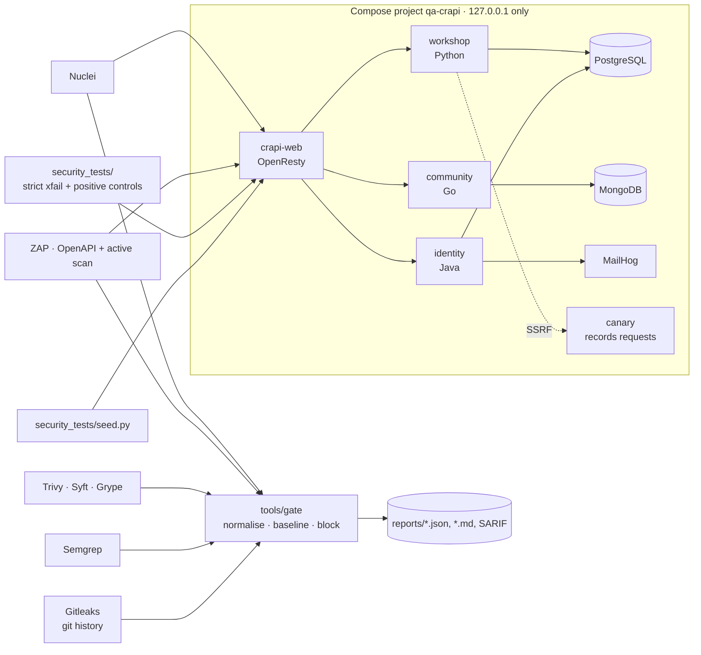

# DevSecOps quality gates · OWASP crAPI

A layered security pipeline against **OWASP crAPI** running only on `127.0.0.1`: secrets, SAST, SCA, SBOM,
DAST and fifteen API-security regression tests, behind one typed quality gate whose baseline makes every
accepted risk carry a reason, an owner and an expiry date.

      

## In 30 seconds

- **15 vulnerabilities reproduced by hand** and pinned by 28 regression tests — 18 strict expected failures
  carrying a FINDING id and **10 positive controls** for what crAPI gets right. Three consecutive runs,
  10 passed / 18 xfailed each, in under 8 s (2026-11-01).
- **Scanners found none of them.** ZAP (API policy, OpenAPI-driven, authenticated) reported 9 alert types,
  max Medium; Nuclei 24 informational matches; Semgrep pointed at the root cause of one. The gap is
  measured and explained in [docs/scanner-coverage.md](docs/scanner-coverage.md).
- **Semgrep missed the SQL injection** that a single quote found by hand — the strongest argument in this
  portfolio for keeping manual testing next to the tools.
- **The gate is demonstrated, not described:** a branch with a fake token turns it red (exit 1) and back
  green, reproducibly — [docs/gate-demo.md](docs/gate-demo.md).
- **CVSS scores are computed**, not estimated: `tools/cvss.py`, checked against published NVD vectors.

## Live reports

CI artefacts and GitHub code scanning arrive with publication (see Roadmap). In the repository today:
[security assessment (PDF)](docs/security-assessment-2026-11-01.pdf) ·
[ZAP report (HTML)](docs/data/2026-11-01/zap-report.html) ·
[raw scanner output](docs/data/2026-11-01/).

## Architecture



Scanners run as containers attached to the stand's network and address it by container name; no port other
than 8888 and 8025 is published, and those only on loopback.

## Stack

| Tool | Why |
|---|---|
| OWASP crAPI v1.1.6, images pinned by digest | Built for the API Security Top 10, several languages for SAST variety, OpenAPI spec ([ADR-001](docs/adr/ADR-001-crapi-target.md), [ADR-002](docs/adr/ADR-002-crapi-stand.md)) |
| pytest 9.2 + httpx | Regression tests as strict expected failures tied to findings |
| Gitleaks 8.30 | Secrets across the full git history of every portfolio repository |
| Semgrep 1.183 | SAST on our code (gate) and on crAPI's source (report) |
| Trivy 0.76, Syft 1.55, Grype 0.121 | Dependencies and configuration, CycloneDX SBOMs, and a second opinion on the same SBOM |
| ZAP 2.17 Automation Framework | Authenticated, OpenAPI-driven DAST with a time budget and SARIF output |
| Nuclei 3.11 | Template-based checks, rate limited, with a self-check pass |
| `tools/gate` | One typed gate over six report formats, baseline with expiry ([ADR-003](docs/adr/ADR-003-gate-policy.md)) |
| uv, ruff, mypy `--strict`, pre-commit | Locked dependencies, clean code, secrets checked before every commit |

## Quick start

Prerequisites: Docker with Compose v2 (≈ 4 GB free for the stand), GNU Make, Python ≥ 3.12 with
[uv](https://docs.astral.sh/uv/). macOS: `brew install uv`. Node.js ≥ 22 only for the PDF report.

**Read [docs/rules-of-engagement.md](docs/rules-of-engagement.md) first.** Everything here attacks software;
it is allowed only against this stand.

```bash
uv sync --frozen --all-groups
make check                 # ruff, mypy --strict, 71 unit tests of the gate and tools (coverage ≥ 90 %)
make stand-up              # crAPI on 127.0.0.1:8888, MailHog on :8025  (~90 s)
make seed                  # users A and B with vehicles, posts and orders (idempotent)
make security-tests        # 10 passed, 18 xfailed
make scan-static           # Gitleaks, Semgrep, Trivy, Syft, Grype
make gate                  # blocking gate over our own code
make scan-dast             # ZAP (~4 min) and Nuclei (~2 min)
make gate-target           # gate over the DAST results
make report                # docs/security-assessment-*.pdf
make stand-down            # stop; stand-reset also drops the volumes
```

## Project structure

| Path | Purpose |
|---|---|
| `stand/` | Compose file for crAPI (digests, loopback only), SSRF canary, ZAP plan, OpenAPI spec, DAST baseline |
| `security_tests/` | Scope-guarded HTTP client, idempotent seed, forged JWTs, the regression tests |
| `tools/gate/` | Report parsers (SARIF, Trivy, Gitleaks, Semgrep, ZAP, Nuclei), baseline with expiry, verdict |
| `tools/cvss.py`, `tools/sca_summary.py`, `tools/report.py` | CVSS 3.1 scoring, Trivy vs Grype comparison, PDF report |
| `scripts/` | One script per scanner; images pinned by tag **and** digest |
| `tests/` | Unit tests of everything in `tools/`, plus the scope guard |
| `docs/` | Findings, static triage, scanner coverage, rules of engagement, threat model, ADRs, raw evidence |

## Test strategy

Risk first: what a real shop would lose is customer data and money, so the manual pass followed the OWASP
API Security Top 10 in that order — authentication, then object- and function-level authorization, then
injection and SSRF. Every reproduced issue became a test that asserts the **secure** behaviour and is a
strict expected failure while the stand is vulnerable, so the suite is green today and goes red the day a
behaviour changes in either direction. Ten positive controls cover what crAPI already does right, so a
regression there fails the build too. Volumes are capped (20 attempts for brute force, one canary for
SSRF) and every request passes a client that refuses any address outside the stand.

## Coverage

| Area | What is covered |
|---|---|
| Authentication (API2) | `alg: none`, published demo secret, tampered payload, anonymous access, OTP throttling (v2 vs v3) |
| Object-level authorization (API1) | Vehicle location, orders, mechanic reports across two accounts |
| Function-level authorization (API5) | Admin video route, management user list, unauthenticated report creation |
| Property-level (API3) | Community feed exposure, order status mass assignment |
| Injection (API8) | SQL (workshop/PostgreSQL), NoSQL (community/MongoDB) |
| SSRF (API7) | `contact_mechanic`, verified by a canary that records the inbound request |
| Supply chain | 6 images: Trivy, Syft SBOM, Grype; this repository: Trivy, Semgrep, Gitleaks over 26 commits |
| Not covered | LLM/chatbot challenges (needs an external API key), shell injection via video conversion (disabled on this stand), the React front end |

## CI/CD

Planned with publication: on pull requests — lint, types, unit tests, Gitleaks on the branch, Semgrep and
Trivy with SARIF uploaded to GitHub code scanning, then the blocking `gate`; nightly — the stand is started
in the job, seeded, the regression suite and both DAST scanners run, `gate-target` blocks on new High or
Critical, and the PDF plus HTML reports are published as artefacts. The red-gate demonstration becomes a
pull request that stays unmerged as evidence.

## How-to

| Task | Command |
|---|---|
| One finding's test | `uv run pytest security_tests -k jwt` |
| Only the positive controls | `uv run pytest security_tests -m positive_control` |
| Tests for a given finding | `uv run pytest security_tests -m "finding"` then filter by name |
| See the gate's reasoning | `make gate` then read `reports/gate.md` |
| Add a finding to the baseline | `uv run python -m tools.gate ... --write-baseline-draft draft.yml`, fill in reason/owner/expiry |
| Reproduce the red gate | `GITLEAKS_LOG_OPTS=--all sh scripts/scan-secrets.sh && make gate` |
| Score a vector | `uv run python -m tools.cvss "CVSS:3.1/AV:N/AC:L/PR:N/UI:N/S:U/C:H/I:H/A:N"` |
| Fresh stand | `make stand-reset && make seed` |

## Results and findings

[docs/findings.md](docs/findings.md) — 15 findings with CVSS 3.1, reproduction and the test that pins each.
[docs/findings-static.md](docs/findings-static.md) · [docs/scanner-coverage.md](docs/scanner-coverage.md) ·
[PDF report](docs/security-assessment-2026-11-01.pdf).

| Severity | Findings |
|---|---|
| Critical (9.1) | `alg: none` accepted by all three services · identity accepts the published demo secret · identity accepts a tampered payload · OTP endpoint without rate limiting |
| High | SQL injection in `apply_coupon` (8.8) · SSRF in `contact_mechanic` (7.7) |
| Medium | 5 × BOLA/BFLA (6.5) · NoSQL injection (5.4) · unauthenticated report creation (5.3) · data exposure and mass assignment (4.3) |

Two findings were discovered **by tests written as positive controls** that failed: the identity service
accepts a token whose payload was edited, and it answers 404 instead of 401 to anonymous requests.

## Decisions

- [ADR-001](docs/adr/ADR-001-crapi-target.md) — crAPI over Juice Shop, VAmPI, DVWA
- [ADR-002](docs/adr/ADR-002-crapi-stand.md) — how the stand is run: digests, loopback, canary, no chatbot
- [ADR-003](docs/adr/ADR-003-gate-policy.md) — what blocks a build and what is only reported

## How AI was used

The owner defined the goals and scope and approved the strategy and tools. An AI coding assistant
(Claude Code) wrote most of the scripts, tests and documentation within that plan. Every finding here was
reproduced by hand against the local stand before a test was written for it, and every number comes from
the runs whose raw output is in [docs/data/2026-11-01/](docs/data/2026-11-01/).

## Roadmap & known limitations

- CI on GitHub Actions, SARIF upload to code scanning, nightly reports (needs the GitHub repository).
- ZAP's out-of-band (OAST) checks are off by design: they would send traffic to an external service. SSRF
  is verified by the local canary instead.
- Nuclei runs a fixed tag selection; a weekly full-template run would catch newly published CVEs.
- The chatbot (LLM) challenges and the React front end are untested.
- Image SCA is report-only; crAPI's images carry hundreds of known CVEs that nobody here can fix.
- Verified on Windows 11 x86_64 with Docker Desktop; every image also has `linux/arm64`, but macOS and Linux
  runs are still pending.

## Licence and credits

MIT © 2026 Taras Bilokin — [LICENSE](LICENSE). OWASP crAPI is © OWASP, Apache-2.0, used as published
container images (v1.1.6) and as source for SAST; `stand/crapi-openapi-spec.json` and `stand/keys/jwks.json`
come from that release. Built with Gitleaks (MIT), Semgrep (LGPL-2.1), Trivy (Apache-2.0), Syft and Grype
(Apache-2.0), OWASP ZAP (Apache-2.0), Nuclei (MIT), pytest, httpx and markdown-it-py (MIT).
