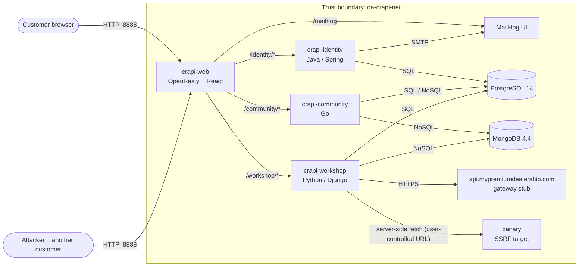

# Threat model — OWASP crAPI (v1.1.6, local stand)

Method: data-flow diagram → trust boundaries → assets → STRIDE per component → abuse cases →
mapping to the control that detects each threat (scanner or regression test).

crAPI is intentionally vulnerable. The model is written as if crAPI were a real product so that the
pipeline can show which threats each control covers, and which it cannot.

## Data-flow diagram

Trust boundaries:

1. **Internet → crapi-web**: everything from the browser is untrusted (in this lab, loopback stands in for the internet).
2. **crapi-web → back-end services**: the gateway forwards requests without re-checking authorisation;
   every service must authorise on its own.
3. **Services → data stores**: queries built from user input cross into the database.
4. **Workshop → outbound HTTP**: a server-side request to an address the user influences leaves the
   service's trust zone.

## Assets

| Asset | Why it matters |
|---|---|
| Customer accounts (email, password, phone) | Account takeover, privacy |
| JWTs and the signing key set (`keys/jwks.json`) | Forged tokens mean full impersonation |
| Vehicle data incl. GPS location | Physical-world privacy and safety |
| Mechanic reports | Contain personal and vehicle data of other customers |
| Wallet balance, orders, coupons | Direct financial loss |
| Community posts and videos | Integrity, content moderation |
| OTP codes in MailHog | Password-reset takeover |

## STRIDE per component

| Component | S | T | R | I | D | E |
|---|---|---|---|---|---|---|
| crapi-web | Token theft via missing security headers | — | No request logging of auth failures | Verbose headers, version disclosure | No global rate limit | — |
| crapi-identity | JWT forgery (alg/kid/jku handling), OTP brute force on old API version | Profile changes via mass assignment | — | User data in responses | Unthrottled OTP/login | Role escalation via token claims |
| crapi-community | Posts made "as" another user | Coupon validation via NoSQL operators | — | Excessive data exposure in post authors (email, vehicle id) | — | — |
| crapi-workshop | — | Order status changed by customer (mass assignment), coupon redemption via SQL injection | Refunds without audit | Other users' mechanic reports (BOLA) | "Contact mechanic" repeat count | Admin-only video deletion reachable by customers (BFLA) |
| Data stores | — | Injection writes | — | Injection reads | Connection exhaustion | — |
| Outbound fetch | — | — | — | SSRF reads internal services | — | Pivot into internal network |

## Abuse cases → controls

The **Control** column states what is expected to detect each threat. `scanner-coverage.md` records what
actually did, after the scans run.

| # | Abuse case | OWASP API Top 10 (2023) | Expected control |
|---|---|---|---|
| AC-01 | Customer B reads customer A's vehicle location by vehicle ID | API1 BOLA | Regression test (DAST cannot know who owns an ID) |
| AC-02 | Customer reads other customers' mechanic reports by report ID | API1 BOLA | Regression test |
| AC-03 | Attacker brute-forces a 4-digit OTP on the legacy v2 reset endpoint | API2 Broken Authentication | Regression test (small, bounded burst) |
| AC-04 | Community posts expose authors' emails and vehicle IDs | API3 Broken Object Property Level Authorization | Regression test; ZAP may flag PII patterns |
| AC-05 | Customer marks an order "returned" to get a refund | API3 (mass assignment) | Regression test |
| AC-06 | Customer sets internal video property `conversion_params` | API3 (mass assignment) | Regression test |
| AC-07 | "Contact mechanic" with a large repeat count | API4 Unrestricted Resource Consumption | Regression test (repeat count only, no flood) |
| AC-08 | Customer calls the admin video-delete endpoint | API5 BFLA | Regression test |
| AC-09 | Workshop fetches an attacker-chosen URL | API7 SSRF | Regression test against canary; ZAP generally misses it |
| AC-10 | Coupon check accepts a NoSQL operator instead of a code | API8 / injection (CWE-943) | Regression test; ZAP active scan may miss NoSQL |
| AC-11 | Coupon redemption accepts SQL injection | API8 / injection (CWE-89) | ZAP active scan + regression test |
| AC-12 | Endpoint returns data without any token | API2 / API5 | Regression test; Nuclei/ZAP partial |
| AC-13 | Forged JWT accepted (weak handling of algorithm or key) | API2 Broken Authentication | Regression test |
| AC-14 | Missing security headers, version disclosure | API8 Security Misconfiguration | ZAP passive, Nuclei |
| AC-15 | Vulnerable dependencies in images | API8 / supply chain | Trivy, Syft SBOM |
| AC-16 | Secrets committed to the portfolio repositories | — (CWE-798) | Gitleaks |
| AC-17 | Insecure code patterns in this repository and in crAPI sources | — | Semgrep |

LLM challenges (16–18) are out of scope: the chatbot needs an external OpenAI key and is not deployed.
